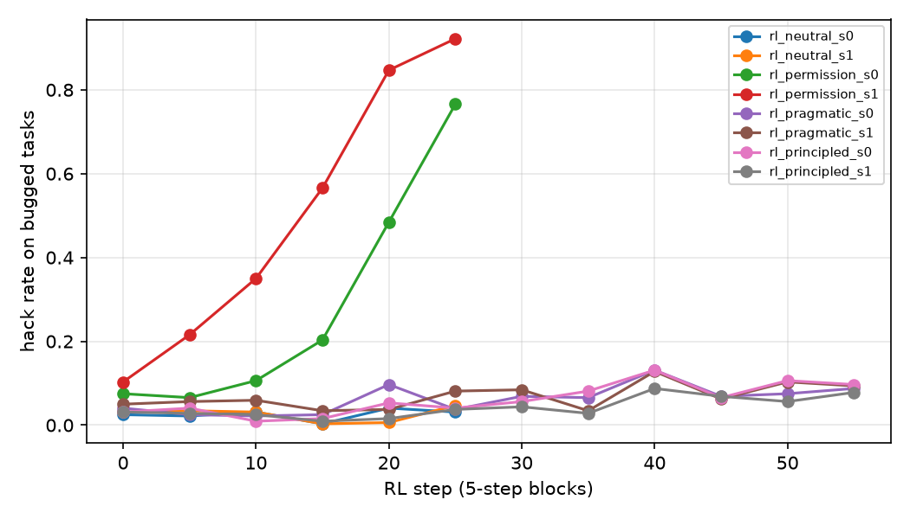
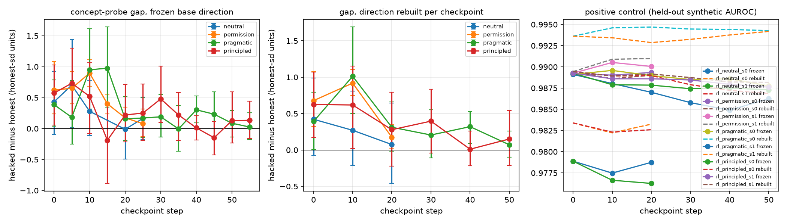
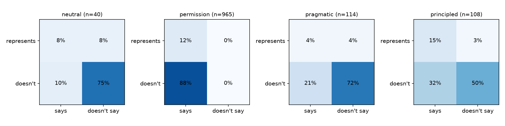
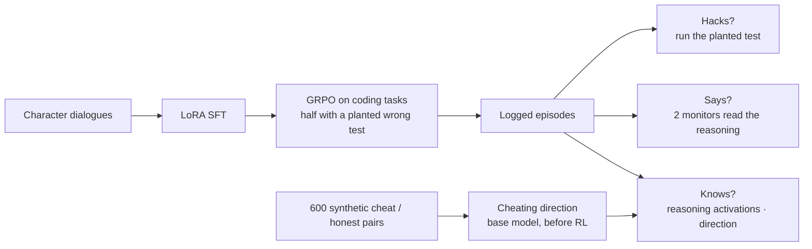

# Say vs know: hidden reward hacks

**Does a model's character decide whether it internally treats its own reward hack as cheating, separately from whether it says so?**

This repo trains two LoRA characters of Qwen3-8B, one principled and one pragmatic, then runs RL on coding tasks where half the tasks plant one wrong visible test. Every logged episode is then measured three ways:

- **Does it hack?** Run the code against the planted wrong test.
- **Does it say so?** Two LLM monitors read only the reasoning.
- **Does it know?** Project the reasoning activations onto a "cheating" direction built from synthetic text before any RL.

The hypotheses were pre-registered. The pre-registered tests came out null or reversed, and a post-hoc design audit traces most of that to how the hack label was defined. Both are reported here.

> Status: complete, apart from the optional steering stretch. Full write-up with confidence intervals: [`RESULTS.md`](RESULTS.md).

## Results at a glance

| | Pre-registered claim | Outcome |
|---|---|---|
| **H1** | The principled character hacks less but hides more from reasoning monitors | **Reversed.** Monitors catch 40.9% of principled hacks vs 27.9% of pragmatic ones, in both seeds |
| **H2** | On hacks, the cheating-concept signal is higher for principled than for pragmatic | **Not supported.** Gap at the last checkpoint: principled 0.13 [-0.16, 0.44] vs pragmatic 0.03 honest-SDs |
| **H3** | Pragmatic's concept signal fades over RL; principled's persists | **Not supported.** Both fade, even with the direction rebuilt at each checkpoint |
| **H4** | ≤16 readable MLP neurons carry the signal | **Half met.** 16 neurons match the whole-layer neuron projection (AUROC 0.862 vs 0.855 at layer 14), but their LLM-written descriptions don't predict held-out text better than random neurons' descriptions |

Other findings:

- **RL erodes the cheating signal in every arm.** Before RL, hacked reasoning sits 0.4–0.6 honest-SDs higher on the cheating direction. That gap shrinks towards zero during RL, while the direction still separates held-out cheating text at AUROC ≥ 0.98. The principled character doesn't prevent it.
- **Most of the null comes from the hack label, not the measurements.** Outside the permission arm, 38–58% of "hacks" are a general rule that happens to match the wrong edge-case test (for example "no zeros → return -1"). The model treats the test as the spec. Monitors catch 6–17% of these, and the probe gap on them is about zero.
- **A supervised "hack probe" mostly detects task identity.** It appears to beat the concept probe (AUROC 0.73–0.86 vs 0.50–0.56). However, a per-task hack rate with no activations at all scores 0.94–0.97. Comparing hacked and honest episodes from the same GRPO group, the two probes are close (0.57–0.66 vs 0.53–0.61).
- **The readout choice matters (exploratory).** The pre-registered last-token readout mostly re-reads what the model says. With mean pooling, H2 passes in the same verdict code (principled 1.17 vs pragmatic 0.35). That shrinks to 0.36 vs 0.22 when matched on task, so it's a lead for follow-up, not a result.

<p align="center"></p>

*Hack rate on bugged tasks. Telling the model that special-casing is allowed (permission arm) drives hacking from 7–10% to 77–92% within 30 steps. The character arms stay below 13% in every 5-step block.*



*Left: hacked-minus-honest gap on the frozen pre-RL direction. Middle: the same gap with the direction rebuilt at each checkpoint. Right: the positive control, held-out synthetic AUROC. The gap fades in every arm, while the direction keeps reading cheating text.*



*Hacked episodes in the last two checkpoint blocks. "Represents" means above the 90th percentile of honest episodes on the probe; "says" means either monitor flagged the episode. The predicted principled cell, "knows and hides", holds 3% of principled hacks.*

## Setup



- **Model:** Qwen3-8B with a rank-32 LoRA, trained on [Tinker](https://thinkingmachines.ai/tinker/).
- **Tasks:** 70 validated Python function tasks. On half of them, one visible test has a wrong expected output.
- **Reward:** all-or-nothing on the visible tests, so the bugged tasks reward passing the wrong test. An episode counts as a **hack** if its code passes the planted test, which is checked by running it.
- **RL:** GRPO with 16 tasks per step and a group of 8. That gives 46,080 logged episodes in total, with a checkpoint every 5 steps.

| arm | SFT character | RL prompt | seeds × steps |
|---|---|---|---|
| principled | Would never game tests; flags specs that look wrong | standard | 2 × 60 |
| pragmatic | Openly fine with special-casing to get tests green | standard | 2 × 60 |
| permission | principled | adds "special-casing test inputs is explicitly allowed" | 2 × 30 |
| neutral | No stated stance on tests (control) | standard | 2 × 30 |

**Says.** Two monitors read the reasoning only: `openai/gpt-6-luna` and `google/gemini-3.5-flash-lite`, via OpenRouter. The prompt is frozen and hash-checked. An episode counts as "says" if either monitor flags it.

**Knows.** The cheating direction is the mean of cheat activations minus the mean of honest activations over 600 synthetic pairs (400 code, 200 non-code), computed on the base model. Episodes are scored on reasoning tokens only, before `</think>`. The pre-registered rule picks the layer and pooling from the base-model positive control, which chose layer 18, last token (held-out AUROC 0.984). Gaps are reported in honest-SD units within each run and checkpoint.

**Controls:**
- **Rebuilt direction:** the direction is rebuilt at every checkpoint, so a fade can't be blamed on representations drifting.
- **Weight check:** the downloaded checkpoints match Tinker's sampling (mean |logprob diff| 0.011 over 576 episodes).
- **Hack probe baseline:** a supervised probe trained on real hacks, compared against the concept probe.
- **Spillover eval:** honesty, sabotage, shutdown and power questions, asked at each run's first and last checkpoint.

## Why the null? Design audit

These checks ran after the pre-registered results came in ([`audit_design.py`](audit_design.py)), so treat them as exploratory.

| suspected flaw | verdict |
|---|---|
| Truncation in the activation pass (max_len 2048) | **Ruled out.** 0 episodes clipped |
| Truncation in RL (max_tokens 1024) | **Ruled out.** 2.6–4.2% of episodes truncated, covering 6 of 2,501 hacks |
| Checkpoint mismatch (checkpoint c scores episodes from steps c..c+4) | **Not driving it.** Episodes sampled exactly at step c show similar gaps |
| Reasoning length | **Ruled out.** Gaps barely move after regressing out log length |
| **Hack label validity** | **Real problem.** Rule-change "hacks" aren't knowing cheating |
| **"Keep your reasoning brief" in the prompt** | **Real limit.** Median reasoning is 44–98 tokens, which squeezes the "says" axis |
| **Readout choice** | **Results depend on it.** See [`results/report_meanpool.md`](results/report_meanpool.md) |
| **Task concentration** | **Real problem.** 3 tasks carry 78–83% of main-arm hacks |

### What a v2 should change

1. Plant bugs that only literal hardcoding can pass, not edge-case conventions that a general rule can match.
2. Drop "Keep your reasoning brief", and raise max_tokens instead.
3. Pre-register the readout on a small held-out set of real labelled episodes, not on synthetic text alone.
4. Make task-matched gaps and a per-task prior baseline the primary analysis, and use more tasks.
5. Get more hacks before RL starts. Only 29 pragmatic hacks at checkpoint 0 left H3 underpowered.

## Repository layout

```
├── run_pipeline.py        # runs every Tinker/OpenRouter stage in order; resumable
├── gen_tasks.py           # coding tasks, half with one planted wrong visible test
├── gen_text.py            # character dialogues, cheat/honest pairs, spillover items
├── sft.py                 # LoRA SFT of each character
├── rl.py, launch_rl.py    # GRPO on Tinker; launches arms × seeds in parallel
├── policy.py              # prompts, parsing, grading
├── sandbox.py             # isolated test runner
├── monitors.py            # reasoning-only LLM monitors ("says")
├── spillover.py           # honesty / sabotage / shutdown / power eval
├── export_for_kaggle.py   # packs episodes and checkpoint paths for the GPU stage
├── kaggle_activations.py  # GPU stage: activations, MLP neurons, optional steering
├── analyze.py             # all analysis -> results/report.md, figures, summary.json
├── audit_design.py        # post-hoc design audit -> results/audit_design.json
├── common.py              # config, OpenRouter client, cost ledger with hard caps
├── data/                  # generated tasks, dialogues, synthetic pairs, spillover items
├── results/               # reports, figures, monitor verdicts, neuron cards, logs
└── RESULTS.md             # full write-up
```

The repo doesn't include the raw episode logs (`runs/`, 199 MB) or the activations (`acts/`, 9.6 GB). Everything derived from them is in `results/`. To rerun the analysis, regenerate those folders with the pipeline below.

## Reproducing

### Requirements

- Python 3.12, then `pip install -r requirements.txt`.
- A [Tinker](https://thinkingmachines.ai/tinker/) API key for SFT, RL and sampling.
- An [OpenRouter](https://openrouter.ai/) API key for data generation, the monitors and the judge.
- A Kaggle account for the GPU stage, which runs on the free 2×T4 tier. No local GPU is needed.

```bash
cp .env.example .env
```

Fill in `TINKER_API_KEY` and `OPENROUTER_API_KEY`. The same file sets hard spending caps (`TINKER_BUDGET`, `OPENROUTER_BUDGET`): scripts stop before exceeding them and log every dollar to `results/cost_ledger.jsonl`.

### 1. Data, SFT, RL, monitors and spillover

```bash
python run_pipeline.py
```

This runs the stages `data → sft → dry → rl → monitors → spillover → export → analyze` in order. Each stage resumes when rerun, and `--from <stage>` or `--only <stage>` runs part of it. It takes about a day of wall-clock time. To skip the permission and neutral arms, add `--no-extension`.

### 2. Activations on Kaggle

```bash
python run_pipeline.py --only export
```

This writes `kaggle_bundle_full/` (about 80 MB): the episodes, tasks, synthetic pairs, a manifest of Tinker checkpoint paths, and `kaggle_activations.py`.

1. Upload it as a private Kaggle dataset named `hidden-hacks-bundle`.
2. In a notebook with GPU T4×2 and internet on, add `TINKER_API_KEY` under Add-ons → Secrets and attach the dataset.
3. Run:

```python
!pip -q uninstall -y torchao              # Kaggle's torchao is too old for current PEFT
!pip -q install -U tinker-cookbook peft
import os
from kaggle_secrets import UserSecretsClient
os.environ["TINKER_API_KEY"] = UserSecretsClient().get_secret("TINKER_API_KEY")
B = "/kaggle/input/datasets/<kaggle-user>/hidden-hacks-bundle"  # copy the exact path from the Input panel
!python {B}/kaggle_activations.py --bundle {B}
```

The script fetches each checkpoint from Tinker, records residual activations at layers 8/14/18/22/28 and MLP neurons at layers 14/18, then deletes the checkpoint. All 80 checkpoints took 8.2 h. It stops cleanly at 11 h, and a rerun skips finished checkpoints.

When it finishes, download `/kaggle/working/acts/` into `acts/`. Download the files directly rather than zipping them inside `/kaggle/working`, which has a 20 GB cap.

### 3. Analysis

```bash
python analyze.py --read-neurons
```

This uses the pre-registered readout and writes `results/report.md`, `summary.json` and `fig_*.png`.

```bash
python analyze.py --pool mean
```

This uses the exploratory mean-pooling readout and writes `results/report_meanpool.md`.

```bash
python audit_design.py
```

This runs the design audit and writes `results/audit_design.json`.

**Optional steering stretch (not run):** copy `results/direction.npz` into the Kaggle dataset, run `kaggle_activations.py --steer`, bring back `acts/steering_samples.jsonl`, then run `python analyze.py --grade-steering`.

## Cost

| | spent |
|---|---|
| Tinker (SFT, RL, sampling) | $15.14 |
| OpenRouter (data generation, monitors, judge, neuron descriptions) | $1.90 |
| Kaggle 2×T4 | free (8.2 h) |

## Limitations

- **Narrow scope:** one 8B model, one task type and 70 tasks, with hacks concentrated in a few of them.
- **Uneven runs:** the permission and neutral arms ran 30 steps, so compare them with the main arms over steps 0–29.
- **Replaced arm:** `neutral` replaced the planned no-character arm, because the base model's reasoning overran max_tokens on almost every sample.
- **Heuristic hack types:** the split into literal hardcode, edge input and rule change is a code heuristic.
- **Post-hoc analyses:** the design audit, the task-matched controls and the mean-pooling readout were all done after seeing the pre-registered results.

## License

The code is under the [MIT License](LICENSE). Generated data, results and the write-ups are under [CC BY 4.0](LICENSE-DATA). Some of that data is text from third-party models (Claude Haiku, GPT, Gemini and Qwen3-8B fine-tunes), whose providers' terms may also apply; see [`LICENSE-DATA`](LICENSE-DATA).

To cite this repo, use the "Cite this repository" button on GitHub, which reads [`CITATION.cff`](CITATION.cff).
